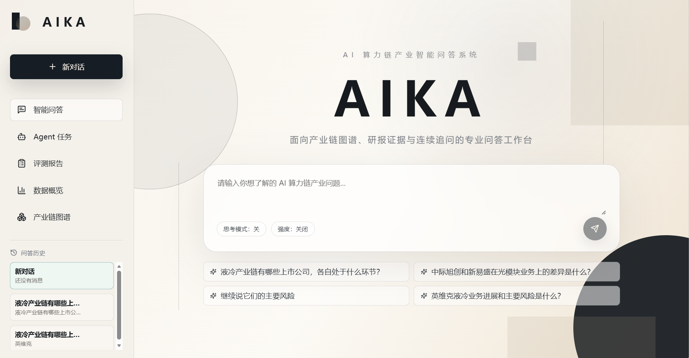
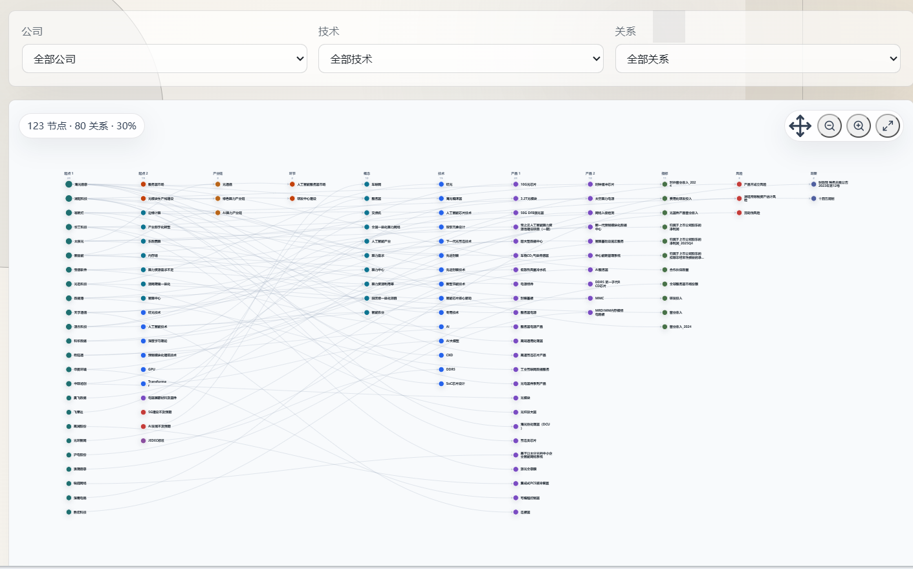
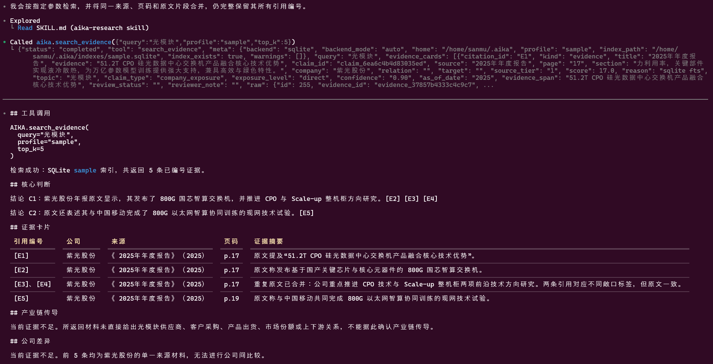
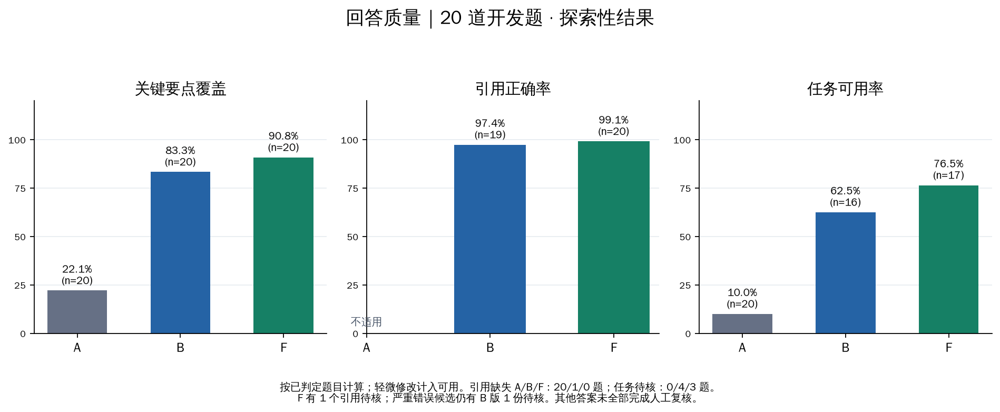
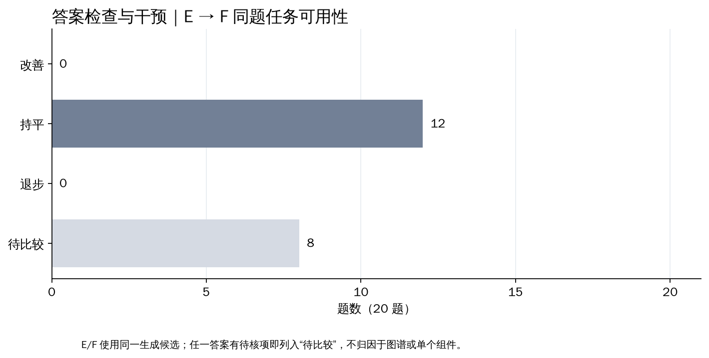
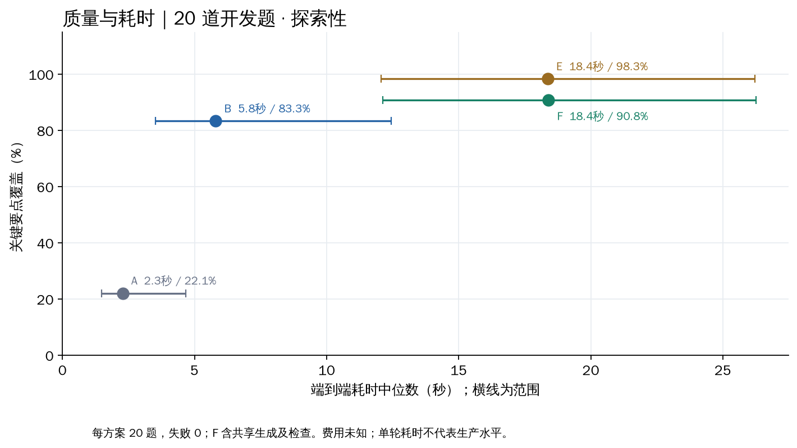

# AIKA

面向 AI 算力产业链的证据驱动投研问答系统，结合 Agent、RAG 和知识图谱，支持产业链分析、公司对比、风险识别与研究报告生成。研究结果附带证据引用，可通过 MCP 和 Skill 接入第三方 Agent。

## 项目展示

### 前端页面



### 知识图谱



### agent问答展示




## 量化评估（探索性）

以下结果来自 2026 年 11 月对 **20 道开发题**的单轮实验，题目涵盖事实查询、公司比较、数字口径和资料不足；资料截止 2026-05-15，生成模型为 `deepseek-chat`。这是开发过程中的观察，**不是独立测试或产品准确率**：部分评分仍待核，部分专家意见尚未映射到评分，数值可能变化。

图中比较了四种回答方式：

| 方案 | 回答方式 | 用来观察什么 |
|---|---|---|
| **A：直接回答** | 模型只根据问题和自身已有知识回答，不检索项目资料。 | 没有外部资料时的回答情况。 |
| **B：基础检索** | 先检索一次相关资料，再让模型根据检索结果回答。 | 简单使用检索资料后的回答情况。 |
| **E：Agent 初稿** | Agent 规划问题、检索并检查资料，必要时补充检索，然后生成初稿；不对最终答案进行检查和修改。 | 完整检索流程生成的原始回答。 |
| **F：Agent 最终回答** | 使用与 E **同一份初稿和证据**，再检查最终答案，必要时修改或收缩表述。 | 最终答案检查与干预带来的变化。 |

B 与 F 对比的是整个回答流程，不能把差异归因于某一个组件；E 与 F 共用初稿，因此适合观察最后检查和干预的整体作用。







本轮每方案 20 题、运行失败 0；费用未知。评分口径、待核范围、配置和局限见[详细报告](docs/eval-pilot/report.md)。

## 主要功能

- **证据驱动问答**：结合原文检索、结构化 Claim 和知识图谱，生成带引用的回答。
- **投研 Agent**：支持任务规划、证据检索和研究报告生成。
- **MCP / Skill**：在 Claude Code 或 Codex 中调用本地投研工具。
- **Web 开发界面**：查看对话、证据、图谱和 Agent 任务，适合本地调试与演示。

技术栈：Python、LangGraph、FastAPI、React、SQLite、PostgreSQL / ParadeDB、Neo4j。

## 快速体验 MCP

需要 Python 3.11 或更新版本。安装后使用内置示例数据创建本地 SQLite 索引，无需启动数据库或 Web：

```bash
pip install aika-research-mcp
aika init --sample
aika build-index
aika doctor
aika demo
```

接入 Codex 或 Claude Code（需先安装对应宿主）：

```bash
# Codex
aika mcp install --host codex --scope user --with-skill

# Claude Code
aika mcp install --host claude-code --scope user --with-skill
```

重启宿主后，可尝试：`使用 $aika-research 分析液冷产业链，要求保留 citation id。` 示例知识包仅用于功能体验，不代表完整投研覆盖。

## 运行 Web 开发版

需要 Python 3.11+、[uv](https://docs.astral.sh/uv/)、Node.js 22+ 和 npm。在项目根目录安装依赖：

```bash
uv sync
cd web
npm ci
cd ..
```

先以离线模式启动，适合查看界面和截图。分别在两个终端运行：

```bash
# 终端 1：后端，使用 CSV 图谱，不调用 LLM 或 PostgreSQL
QA_DISABLE_POSTGRES=true QA_GRAPH_BACKEND=csv LLM_API_KEY=replace-me \
  uv run python main.py api --host 127.0.0.1 --port 8000 --reload
```

```bash
# 终端 2：前端
cd web
npm run dev
```

打开 <http://localhost:5173>，后端状态可在 <http://127.0.0.1:8000/api/status> 查看。离线模式的检索和回答能力有限；Web 是本地开发测试台，请勿直接暴露到公网。

### 使用完整检索与模型

1. 准备 Docker 和 Docker Compose；如尚无 `.env`，执行 `cp .env.example .env`，然后配置 `LLM_API_KEY`，并按所用服务调整 `LLM_BASE_URL`、`LLM_MODEL`。
2. 启动数据库、执行迁移并导入本地检索数据：

   ```bash
   docker compose up -d postgres
   uv run python scripts/migrate_postgres.py
   uv run python scripts/bootstrap_postgres_retrieval.py
   ```

   导入需要本地已有 `data/rag/documents.jsonl` 和 `data/curated/` 数据；原文 RAG 数据不随公开示例知识包提供。数据准备和索引构建见[详细文档](docs/README-extended.md)。语义检索还需配置 Embedding 服务并构建向量索引。
3. 分别启动后端和前端：

   ```bash
   # 终端 1
   uv run python main.py api --host 127.0.0.1 --port 8000 --reload
   ```

   ```bash
   # 终端 2
   cd web
   npm run dev
   ```

默认使用 CSV 图谱，Neo4j 可作为可选增强。模型和 Embedding 调用可能产生费用。


## 动态知识库

完整 PostgreSQL 检索模式下，先执行 `uv run python scripts/migrate_postgres.py`，然后启动后端和前端，在侧栏选择“知识库”。支持收录文本、可提取文字的 PDF 和公开网页，查看状态及原文，编辑标题、标签、主题和公司，重新处理或删除资料。对话中可输入“把‘这段文字’存入知识库”或“把 https://example.com 存入知识库”。正常问答会检索可用资料并展示证据。离线演示模式不支持动态知识库。

页面显示“可检索”表示关键词索引已完成；语义索引的状态单独展示。配置 Embedding 服务时，资料文本可能发送给该服务。网页受登录、反爬和网络条件影响，扫描件不支持 OCR。`KNOWLEDGE_MAX_BYTES`（默认 20 MiB）和 `KNOWLEDGE_FETCH_TIMEOUT`（默认 15 秒）可配置。用户资料保存在 PostgreSQL，删除会清理数据库中的原始内容和检索块；数据库备份的清理由部署者管理。本地开发服务没有远程访问所需的身份认证，不应直接暴露到公网。


## 同会话角色协作

在“智能问答”的同一输入框提交任务，系统按实际需要展示首席研究员、资料管理员、研报分析师、产业研究员与证据审查员。点击“角色协作”查看按发生顺序保存的状态、工作摘要、失败原因与关联原文；流式回答在核查结束前标为草稿。角色事件独立于思考模式显示。

可通过“牵头角色”下拉框或消息开头的 `@研报分析师` 等名称指定角色；下拉框的显式选择优先，其他角色仍可协助。“了解角色”展示职责及可用能力。职责不适用时会给出建议，不执行不适用的操作。资料收录和重新处理会跟踪实际索引状态；失败后可按原资料 ID 重试，不另建资料。

任务和事件随会话保存在 `data/conversations`。刷新、断线或切换会话不会终止后台任务；返回会话后自动恢复事件及最终结果。服务停止或重启导致的中断显示失败，需主动重新提交；同一会话同时执行一个任务，执行期间不能删除会话。当前运行方式为本地单用户、单后端进程，不支持多个进程同时写入同一会话目录。

消息接口支持可选的 `role_id`、`request_id`；重复提交相同请求 ID 会返回原任务。`GET /api/agent/roles` 提供角色资料，`GET /api/conversations/{conversation_id}/tasks/{task_id}/events?after_seq=…` 支持已保存事件重放及后续 SSE 订阅。新增字段兼容已有会话记录，Markdown/JSON 导出包含角色执行记录。


## 项目跟进记录

- [进度与验收边界](PROGRESS.md)：当前完成情况、验证记录和下一步。
- [设计决策](DECISIONS.md)：关键选择、原因、代价和未决事项。
- [接手与恢复流程](AGENTS.md)：如何继续工作、保存与查看检查点。
- `./init.sh status` 查看状态；`./init.sh check` 执行相关回归和前端构建。实现检查点为 `f466506`，可用 `git show --stat f466506` 查看修改范围。
